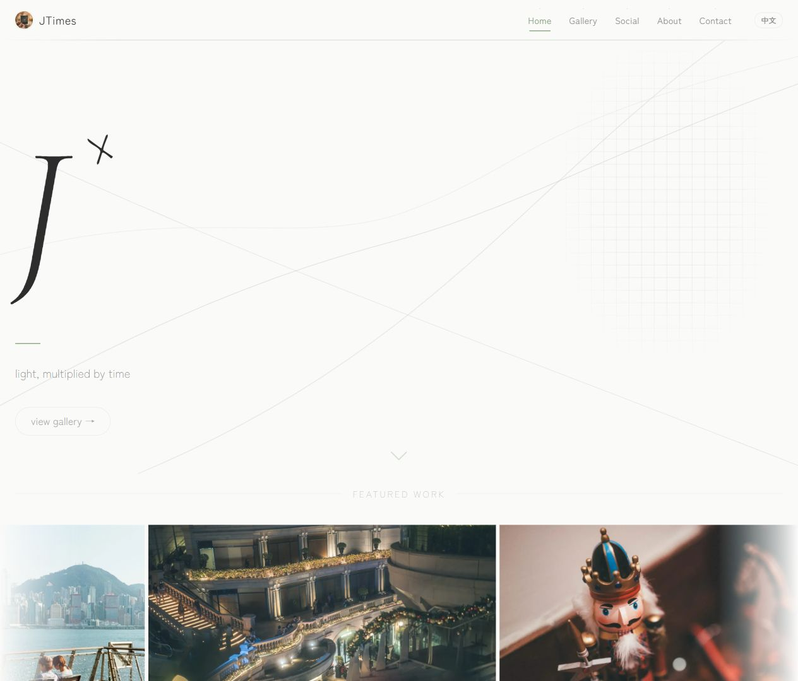
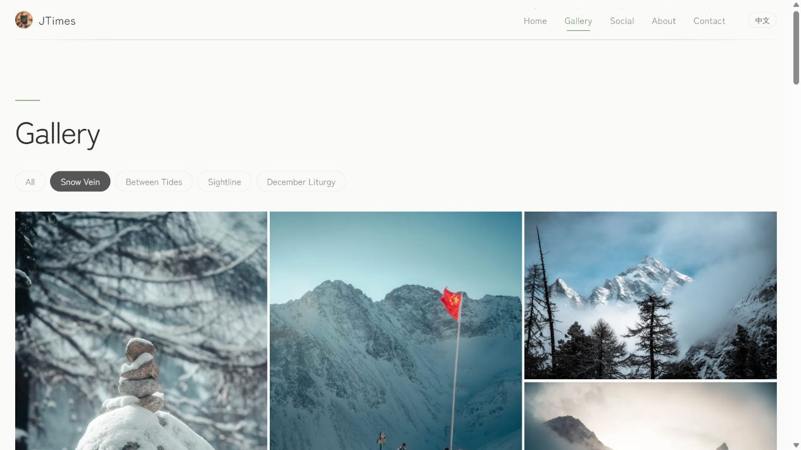
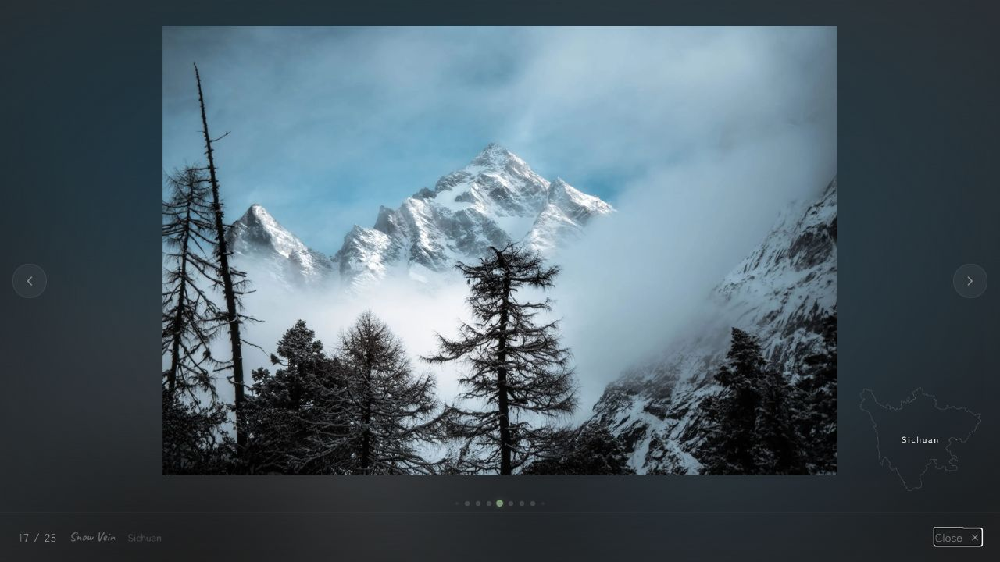

# JTimes

My photography portfolio. The site has an English and a Traditional Chinese gallery, with photographs grouped into series.

[Visit jtimes-visual.com](https://jtimes-visual.com) · [繁體中文](README.zh-Hant.md)



## About JTimes

The name comes from James. **J** is my initial, and **times** means both multiplication and the moments a photograph holds. Said aloud, JTimes sounds a little like James. **J×** is the short version I use as a signature. The idea behind it is “light, multiplied by time.”

## What’s on the site

- The homepage has a scrolling wall of featured photographs.
- The gallery groups work by series and serves different thumbnail sizes for different screens.
- The full-screen viewer lets you move through the selected series by swiping, using the arrow keys or clicking the controls. Some photographs also have a small location map.
- The English and Traditional Chinese galleries share the same photographs, with separate titles and descriptions.

<p>
  
  
</p>

## Project structure

| Path | What’s there |
| --- | --- |
| `src/pages/` | English and Traditional Chinese pages |
| `src/components/gallery/` | Photo grid, series filters, featured wall and full-screen viewer |
| `src/content/photos/` | Photo metadata in Markdown, under `en/` and `zh-cn/` |
| `src/assets/images/photos/` | Images used by both language versions |
| `src/admin/` | Local photo admin and its API |
| `scripts/` | Build checks, image tools and screenshot scripts |

## Run locally

The site uses Astro and Tailwind CSS. Use Node.js 24 and npm.

```sh
npm ci
npm run dev
```

Open [localhost:4321](http://localhost:4321/).

## Manage photos

Set `ADMIN_PASSWORD` in a local `.env` file, then open [the photo admin](http://localhost:4321/admin) while the development server is running. It supports batch uploads and edits. Uploads are compressed to JPEG, and each photo gets one Markdown entry per language.

- Images live in `src/assets/images/photos/`. Photo entries live in `src/content/photos/en/` and `src/content/photos/zh-cn/`.
- To remove a photo from the gallery and homepage, use **Delete** in the admin. It removes both language entries and deletes the image if no other photo entry references it. Keep a copy if the image is new and has never been committed.
- If the admin offers to renumber the series, choose **Cancel** to keep the other titles and numbers. The selected photo has already been deleted by that point.
- To remove a photo from the homepage only, clear its **Featured** setting.

Check the changes with `git status --short`. Edits made in the admin take effect on the public site after you commit and push them.

## Build and deploy

```sh
npm run verify:build
npm run preview
```

The production build is written to `dist/`. Vercel deploys pushes to `main`. The admin runs with the local development server. The Traditional Chinese pages retain their existing `/zh-cn/` URLs and use the `zh-Hant` language tag.

## License and photographs

The [MIT License](LICENSE) covers the site code and accompanying documentation. My photographs and the JTimes avatar are outside that scope. Please contact me for permission to reuse them. Third-party assets retain their own licenses.
