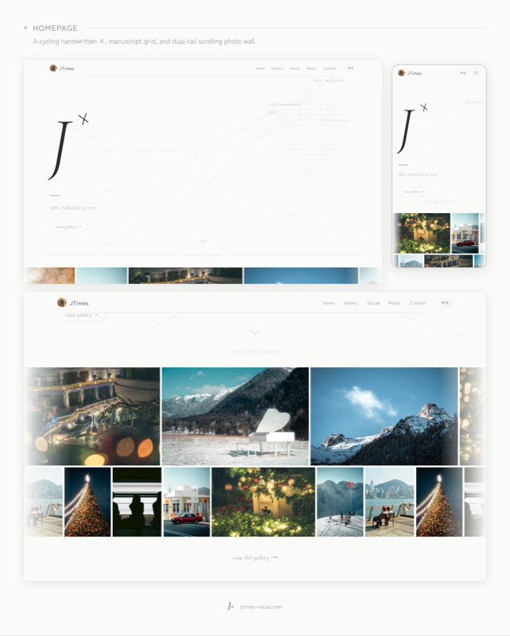

# JTimes

My photography portfolio. The site has an English and a Traditional Chinese gallery, with photographs grouped into series.

[Visit jtimes-visual.com](https://jtimes-visual.com) · [繁體中文](README.zh-Hant.md)



## Run locally

The site uses Astro and Tailwind CSS. Use Node.js 24 and npm.

```sh
npm ci
npm run dev
```

Open [localhost:4321](http://localhost:4321/).

## Manage photos

Set `ADMIN_PASSWORD` in a local `.env` file, then open [the photo admin](http://localhost:4321/admin) while the development server is running. It supports batch uploads and edits. Uploads are compressed to JPEG, and each photo gets one Markdown entry per language.

- Images live in `src/assets/images/photos/`. Photo entries live in `src/content/photos/en/` and `src/content/photos/zh-cn/`.
- To remove a photo from the gallery and homepage, use **Delete** in the admin. It removes both language entries and deletes the image if no other photo entry references it. Keep a copy if the image is new and has never been committed.
- If the admin offers to renumber the series, choose **Cancel** to keep the other titles and numbers. The selected photo has already been deleted by that point.
- To remove a photo from the homepage only, clear its **Featured** setting.

Check the changes with `git status --short`. Edits made in the admin take effect on the public site after you commit and push them.

## Build and deploy

```sh
npm run verify:build
npm run preview
```

The production build is written to `dist/`. Vercel deploys pushes to `main`. The admin runs with the local development server. The Traditional Chinese pages retain their existing `/zh-cn/` URLs and use the `zh-Hant` language tag.

## License

[MIT](LICENSE).
