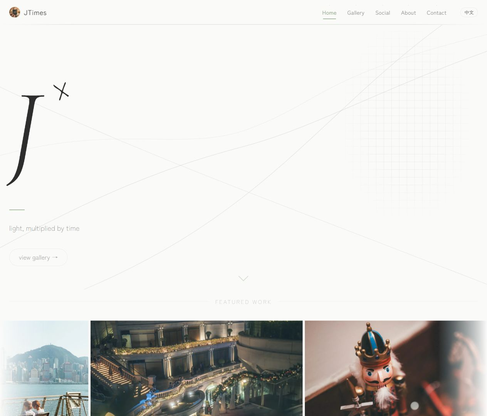
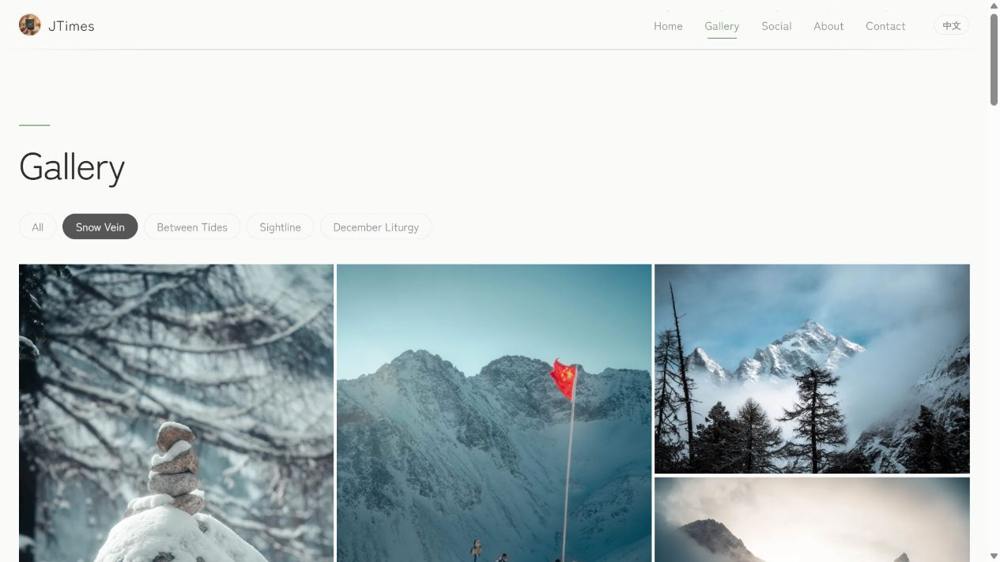
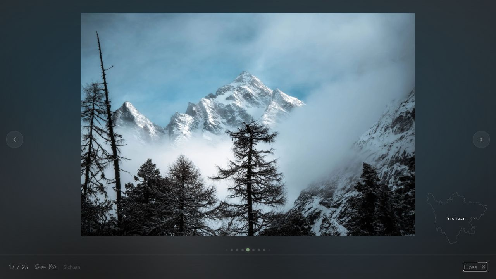

# JTimes

我的攝影作品集。網站提供英文和繁體中文版本，照片按系列瀏覽。

[前往 jtimes-visual.com](https://jtimes-visual.com) · [English](README.md)



## 關於 JTimes

JTimes 來自我的名字 James。**J** 是名字的首字母，**times** 既有相乘的意思，也讓我想到照片留下的那些片刻。唸起來，JTimes 和 James 有點相似。**J×** 是我用在作品上的簡寫簽名。它背後的想法是「光，乘以時間」。

## 網站內容

- 首頁有一面橫向捲動的精選照片牆。
- 作品集可以按系列篩選，縮圖會依螢幕大小載入。
- 全螢幕檢視器可用滑動、方向鍵或畫面上的按鈕瀏覽已選系列，部分照片附有拍攝地點的小地圖。
- 英文和繁中版共用同一批照片，各自有標題和說明。

<p>
  
  
</p>

## 專案結構

| 路徑 | 內容 |
| --- | --- |
| `src/pages/` | 英文與繁中頁面 |
| `src/components/gallery/` | 照片格線、系列篩選、精選照片牆及全螢幕檢視器 |
| `src/content/photos/` | 照片的 Markdown 資料，分為 `en/` 和 `zh-cn/` |
| `src/assets/images/photos/` | 兩種語言版本共用的照片檔案 |
| `src/admin/` | 本機照片管理後台及 API |
| `scripts/` | 建置檢查、圖片工具及截圖腳本 |

## 在本機執行

網站使用 Astro 和 Tailwind CSS。請使用 Node.js 24 和 npm。

```sh
npm ci
npm run dev
```

開啟 [localhost:4321](http://localhost:4321/)。

## 管理照片

在本機的 `.env` 設定 `ADMIN_PASSWORD`，啟動開發伺服器後開啟[照片管理後台](http://localhost:4321/admin)。後台支援批次上傳和編輯，會將照片壓縮為 JPEG，並為每張照片建立兩份語言版本的 Markdown。

- 圖片存於 `src/assets/images/photos/`，照片資料存於 `src/content/photos/en/` 和 `src/content/photos/zh-cn/`。
- 要從作品集和首頁移除一張照片，在後台按 **Delete**。後台會移除兩種語言的資料。若其他照片資料都沒有引用該圖片，圖片檔案也會刪除。若照片還未提交到 Git，請先保留一份備份。
- 若後台詢問是否重新編號，選 **Cancel** 可保留其餘照片的標題和編號。到這一步，選中的照片已經刪除。
- 若只想從首頁移除照片，取消勾選 **Featured**。

用 `git status --short` 檢查改動。將後台的改動提交並推送後，公開網站才會更新。

## 建置與部署

```sh
npm run verify:build
npm run preview
```

正式版的建置產物在 `dist/`。推送至 `main` 後，Vercel 會自動部署。管理後台隨本機開發伺服器執行。繁中頁面沿用 `/zh-cn/` 網址，語言標記為 `zh-Hant`。

## 授權與照片

網站程式碼及相關文件採用 [MIT 授權](LICENSE)。我的攝影作品與 JTimes 頭像另有各自的使用權限，如需重用，請先聯絡我取得同意。第三方素材沿用各自的授權。
